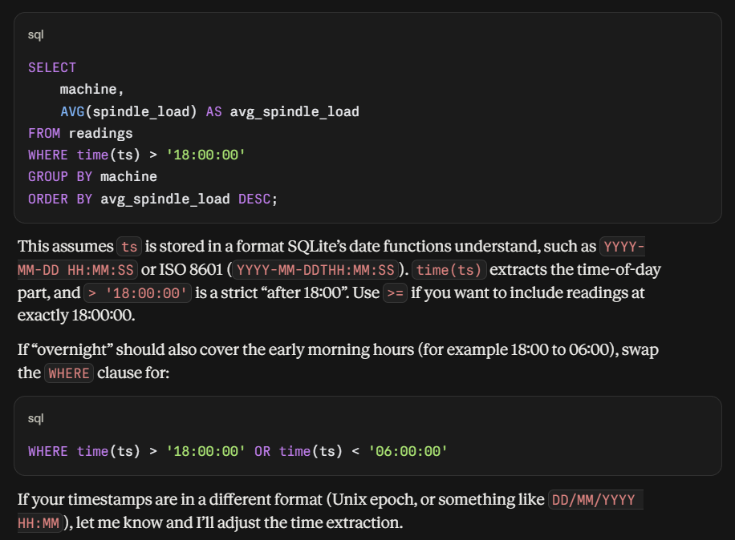
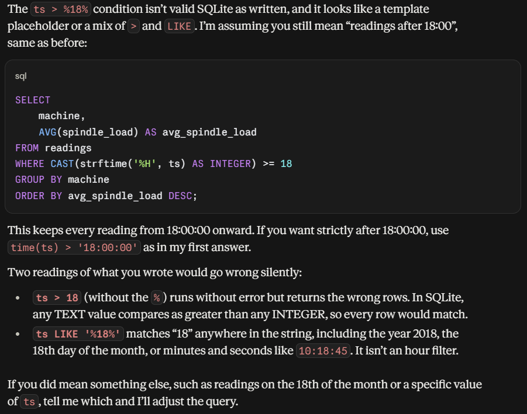
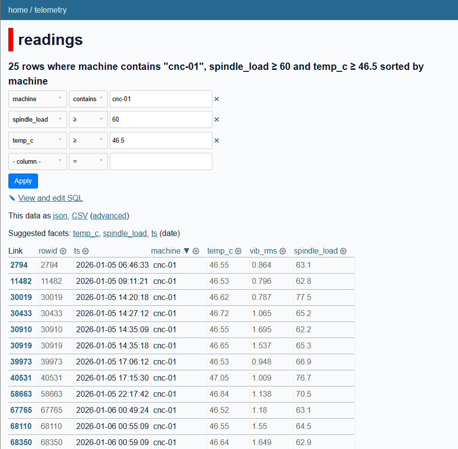
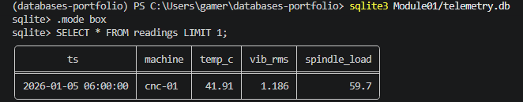
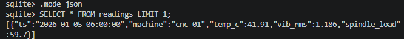
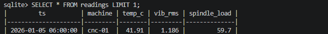
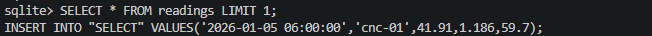
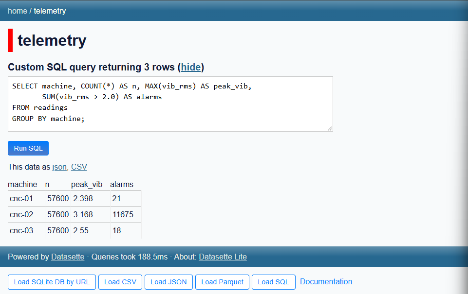

# Module 1: Introduction & Local-First Foundations

## 🎯 Learning Goals
The first class. We open with a short introduction to **how this class works** (Part A), then run this module's studio in the same session, together and in person.

### Learning Goal 1: 
Explain how this class works — the CBL/PBL philosophy, the portfolio-based Kombinationsprüfung, and the "moving bar" of a first-time course.
- [How this class works](https://github.com/Emannual20/databases-portfolio/tree/main/Module01#2-personal-github-portfolio-and-gitignore) - Understanding how the class works and portoflio building

### Learning Goal 2: 
Set up your personal GitHub portfolio from the course template, with a clean first commit and a .gitignore that keeps databases and secrets out of Git.
- [Setting up Github Portfolio](https://github.com/Emannual20/databases-portfolio/tree/main/Module01#2-personal-github-portfolio-and-gitignore) - My personalized Database Portfolio structure and files required
- [First Commit](https://github.com/Emannual20/databases-portfolio/commit/6d6bd10ac56d2942bcba62c1b23a969fb5704b06)
- [.gtiginore File](https://github.com/Emannual20/databases-portfolio/blob/main/.gitignore)

### Learning Goal 3: 
Set up the entire toolchain reproducibly with uv — one fixed Python plus SQLite, DuckDB, Datasette, and more — on Windows, macOS, or Linux, and verify it.
- [Dependency Configurtion](https://github.com/Emannual20/databases-portfolio/blob/main/Module01/pyproject.toml)
- [UV Verification](https://github.com/Emannual20/databases-portfolio/blob/main/Module01/uv-check.py)
- [UV Lock](https://github.com/Emannual20/databases-portfolio/blob/main/uv.lock)

### Learning Goal 4: 
Explain — with a measurement, not a slide — the difference between an embedded database and a client/server database, and why most local apps should not run a server.
- [Embedded vs. client/server, with a measurement](https://github.com/Emannual20/databases-portfolio/blob/main/Module01/README.md#4-embedded-vs-clientserver-with-a-measurement)

### Learning Goal 5:
Load real rows into SQLite and query them from Python using bound parameters.
- [Loading rows into SQLite and querying them from Python](https://github.com/Emannual20/databases-portfolio/blob/main/Module01/README.md#5-loading-rows-into-sqlite-and-querying-them-from-python)

### Learning Goal 6: 
Take a first LLM-generated query, run it, and begin the habit that defines this course: verify before you trust.
- [Verify befroe you trsut an LLM query](https://github.com/Emannual20/databases-portfolio/tree/main/Module01#6-verify-before-you-trust-an-llm-query)

## Reflection 1
[Reflection 1](https://github.com/Emannual20/databases-portfolio/blob/main/Reflections/ref01.md)

<br>
<br>
<br>

## Task Inspirations (Notes & Evidence)
## **1. How this class works**<br>
The course is problem-based: I had to find answers and explanations myself, by reading documentation, asking an LLM, comparing against my team members (Sanjay, Jo Marie and Lin), and fixing my own mistakes. My portfolio (Task 1 and 2) is the evidence so every task has visible proof, such as commands, outputs and screenshots.<br>

**Task Evidence:**
>**Task 1:** [My portfolio](https://github.com/Emannual20/databases-portfolio#sebastians-databases-portfolio) <br>
>**Task 2:** [My partners](https://github.com/Emannual20/databases-portfolio/blob/main/README.md#my-partners) <br>

## **2. Personal GitHub portfolio and .gitignore**<br>
Cloning the course template through the terminal, instead of GitHub Desktop, was the habit the later modules needed. The `.gitignore` taught me a practical lesson keeping databases and secrets our of Git. In Task 11: it blocked `.db` files, so I had to force-add `telemetry.db` to make it reachable by Datasette Lite. That showed me that keeping databases out of Git is a deliberate choice that can be overridden.<br>

**Task evidence:**
> **Task 11:** [Datasette Lite & sqlite-utils](https://github.com/Emannual20/databases-portfolio/tree/main/Module01#task-11)
> - [First Commit](https://github.com/Emannual20/databases-portfolio/commit/6d6bd10ac56d2942bcba62c1b23a969fb5704b06)
> - [.gtiginore File](https://github.com/Emannual20/databases-portfolio/blob/main/.gitignore)<br>

## **3. Reproducible toolchain with uv**<br>
`uv-check.py`, `pyproject.toml` and `uv.lock` pin one Python and the packages so that anyone can rebuild my setup. I used the same tool later with `uvx` to run Datasette and `sqlite-utils` without installing them permanently.<br>

**Task evidence:**
>**Task 3:**
> - UV Verififcation: [uv-check.py](https://github.com/Emannual20/databases-portfolio/blob/main/Module01/uv-check.py)<br>
> - Committed PyProject: [Pyproject.toml](https://github.com/Emannual20/databases-portfolio/blob/main/Module01/pyproject.toml)<br>
> - UV Lock: [uv.lock](https://github.com/Emannual20/databases-portfolio/blob/main/uv.lock)<br>

## **4. Embedded vs. client/server, with a measurement**<br>
Embedded server means a locally run on a machine, it keeps its own data locally. In Task 6 I measured instead of assuming: `telemetry.db` holds 172,800 rows in about 10 MB, queried with no server running. In Task 9, copying it with `.backup` gave the same 10,280 KB, which showed that the whole database is just one file.<br>

**Task Evidence:**
> **Task 6:** [Load real telemetry and query it from Python](https://github.com/Emannual20/databases-portfolio/blob/main/Module01/README.md#task-6-load-real-telemetry-and-query-it-from-python)
> - [Generator Script](https://github.com/Emannual20/databases-portfolio/blob/main/Module01/generate_telemetry.py)
> - [Queries, File Size, Row Count and answers](https://github.com/Emannual20/databases-portfolio/blob/main/Module01/query_results.txt)
> 
> **Task 9:** [Comparing file sizes between backup.db and compact.db, the file sizes are identical](https://github.com/Emannual20/databases-portfolio/blob/main/Module01/README.md#comparing-file-sizes-between-backupdb-and-compactdb-the-file-sizes-are-identical)

## **5. Loading rows into SQLite and querying them from Python**<br>
I loaded the same CSV three ways: a Python loader using `?` placeholders for bound parameters, the `sqlite3` shell with `.import`, and `sqlite-utils insert`. Comparing them showed me the trade-off between keystrokes and control over the schema (for example, `sqlite-utils` left out the `NOT NULL` constraints). <br>

**Task Evidence:**
> - [Load Telemetry File](https://github.com/Emannual20/databases-portfolio/blob/main/Module01/load_telemetry.py)
> - [Queries](https://github.com/Emannual20/databases-portfolio/blob/main/Module01/queries.sql)
> - [Query Result](https://github.com/Emannual20/databases-portfolio/blob/main/Module01/query_results.txt)

## **6. Verify before you trust an LLM query**<br>
In Task 7, the model assumed "overnight" meant 18:00 to midnight, and running both versions showed different averages. Adding `OR time(ts) < '06:00:00'` fixed the definition. I also checked the query plan with `EXPLAIN QUERY PLAN`, and I tried to break the prompt on purpose, which showed me that the model catches invalid SQL but not vague wording.<br>

**Task Evidence:**
> **Task 7:** [LLM asissted-SQL Profitiling task](https://github.com/Emannual20/databases-portfolio/tree/main/Module01#task-7-llm-asissted-sql-profitiling-task)

<br>
<br>
<br>

# Task Personal Profile
**My skills:** Python, Object Oriented Programming, Some Basci micro controller knowledge<br>
**Expectations:** I expect to learn about databases, MYSQL, possibly docker if there is time.

<br>

## Task 4: Which dot command I found most helpful
- [Shell-Tour.txt](https://github.com/Emannual20/databases-portfolio/blob/main/Module01/shell-tour.txt)
- [Tour.sql](https://github.com/Emannual20/databases-portfolio/blob/main/Module01/tour.sql)<br>

**Which dot command did you find the most helpful?** <br>
I found the .help command the most helpful as it showed me all the commands i needed to use. And I also found .schema reading helpful as it allows me to directly read from the database in the command prompt, to verify the data inside.
<br>

> **Dificulties faced :** <br>
> The first run, my shell-tour.txt file would not have the right output and my SQL shell had gotten stuck. By troubleshooting with Claude, I discovered it was a simple syntax error of forgetting to place the ";" at the ned of the SELECT command. (Guess I continued the habit from OOPs 😝)

<br>

## Task 5: Play SQL Island
SQL game progress and reflection can be found here: [sql-island.md](https://github.com/Emannual20/databases-portfolio/blob/main/Module01/sql-island.md)

<br>

## Task 6: Load real telemetry and query it from Python
- [generate_telemetry.py](https://github.com/Emannual20/databases-portfolio/blob/main/Module01/generate_telemetry.py)
- [Queries, Size & Row Count, Answer](https://github.com/Emannual20/databases-portfolio/blob/main/Module01/query_results.txt)

<br>

## Task 7: LLM asissted-SQL Profitiling task

**First Prompt used :**
"Here is my SQLite table: readings(ts TEXT, machine TEXT, temp_c REAL, vib_rms REAL, spindle_load REAL). Write a query that returns, for each machine, the average spindle load for readings taken overnight (after 18:00), ordered by average load descending." <br>

**Output result of prompt :** 


> Notes:<br>
> The intial prompt made the model believe the Query would only last from 18::00 to 00:00, it did not consider for the fact that overnight meant 18:00 - 06:00

**Executing in Terminal:** 
``` sql
sqlite> SELECT
   ...>     machine,
   ...>     AVG(spindle_load) AS avg_spindle_load
   ...> FROM readings
   ...> WHERE time(ts) > '18:00:00'
   ...> GROUP BY machine
   ...> ORDER BY avg_spindle_load DESC;
╭─────────┬────────────────────╮
│ machine │  avg_spindle_load  │
╞═════════╪════════════════════╡
│ cnc-03  │ 60.434039449923603 │
│ cnc-01  │ 60.368453951937767 │
│ cnc-02  │ 60.357216280038891 │
╰─────────┴────────────────────╯
```
Set the over-night definition to 18:00:00 - 06:00:00 <br>

**Executing in Terminal:**
``` sql
sqlite> SELECT
   ...>     machine,
   ...>     AVG(spindle_load) AS avg_spindle_load
   ...> FROM readings
   ...> WHERE time(ts) > '18:00:00' OR time(ts) < '06:00:00'
   ...> GROUP BY machine
   ...> ORDER BY avg_spindle_load DESC;
╭─────────┬────────────────────╮
│ machine │  avg_spindle_load  │
╞═════════╪════════════════════╡
│ cnc-02  │ 60.205972636988683 │
│ cnc-03  │ 60.202878672130012 │
│ cnc-01  │ 60.185554552399474 │
╰─────────┴────────────────────╯
```
**Second prompt:**
EXPLAIN QUERY PLAN "Here is my SQLite table: readings(ts TEXT, machine TEXT, temp_c REAL, vib_rms REAL, spindle_load REAL). Write a query that returns, for each machine, the average spindle load for readings taken overnight (after 18:00), ordered by average load descending." <br>

**Claude's Response:**
``` sql
QUERY PLAN
|--SCAN readings
|--USE TEMP B-TREE FOR GROUP BY
`--USE TEMP B-TREE FOR ORDER BY
```
**Attempting to break Claude (Broken Prompt):**
"Here is my SQLite table: readings(ts TEXT, machine TEXT, temp_c REAL, vib_rms REAL, spindle_load REAL). Write a query that returns, for each machine, the average spindle load for readings ts > %18%, ordered by average load descending."<br>

**Claude's Response:**


**Verification Paragraph:**
In the initial prompt, the model decided that overnight implied 18:00:00 - 00:00:00, and made its own assumption. However, it gave a suggestion to change the timeframe to suit the 18:00:00 - 06:00:00 timeframe as the real overnight definition. By running both commands, we can identify the difference and catch the discrepancy of using the wrong prompt with poor boundaries set. <br>
When trying to break the prompt, Claude managed to catch the error befoire running, such as correctly idenfitfying ts>%18% was not valid SQLite, and corrected itself before returning the commands to be used. <br>

<br>

## Task 8: Publish your data with Datasette

25 rows where machine contains "cnc-01", spindle_load ≥ 60 and temp_c ≥ 46.5 sorted by machine


- [Exported Filtered.csv](https://github.com/Emannual20/databases-portfolio/blob/main/Module01/exported_filtered.csv)

<br>

## Task 9: sqlite3 shell power moves
> Keeping SQL in a file, reduces having to manually type repeated commands, we can create a reusable file with the commands we will use and run the entire file instead, saving time.<br>

Different output modes like .mode box or .mode json are simply different ways to present the data visually in the terminal.<br>

**Box Mode:**<br>


**Json Mode:**<br>


**Markdown Mode:**<br>


**Insert Mode:**<br>


Result.json file here: [result.json](https://github.com/Emannual20/databases-portfolio/blob/main/Module01/result.json)
<br>
### Comparing file sizes between backup.db and compact.db, the file sizes are identical.
> Size of Back Up File: 10280KB <br>
> Size of Compact File: 10280KB <br>

**Claude Explanation:**
.backup copies the database page for page and VACUUM INTO only removes unused free space, so because telemetry.db was loaded once and never had anything deleted, there was no wasted space to remove and both files came out the same size.

Output from joining Tables:
(Insert image of output from joining tables)

**Suprising Command:**
Surprisingly, VACUUM is a compaction tool that had nothing to compact: the database had never had a single row deleted, so it contained zero wasted space, and the “compacted” copy came out byte-for-byte the same size as the original.

<br>

## Task 10: Datasette - Facets, filters, and the JSON API

Base URL: http://127.0.0.1:8001/telemetry/readings
57,600 rows where machine = "cnc-01" sorted by rowid: http://127.0.0.1:8001/telemetry/readings?_sort=rowid&machine__exact=cnc-01

Facet By temperature where machine = "cnc-01":
```
temp_c >30 ✖

44.52 126
44.26 121
44.67 120
44.76 120
44.35 119
44.36 118 
...
```

<br>

## Task 11: Datasette Lite & sqlite-utils — the same job, other tools

Tool Box: [toolbox.md](https://github.com/Emannual20/databases-portfolio/blob/main/Module01/toolbox.md)
<br>
Datasette Lite:


> sqlite-utils took the fewest keystrokes: one insert command created the table, guessed the column types, and loaded all 172,800 rows, where the sqlite3 shell needed a CREATE TABLE plus .mode csv and .import, and Python needed a whole script. The Python loader was the clearest, because the schema, including the NOT NULL constraints that sqlite-utils left out, is written down explicitly, and the script can be rerun and kept in version control. I would use sqlite-utils for quickly exploring a CSV, the sqlite3 shell for one-off inspection and ad-hoc queries, and Python when the load is part of a repeatable pipeline that needs control over the schema or data cleaning.
