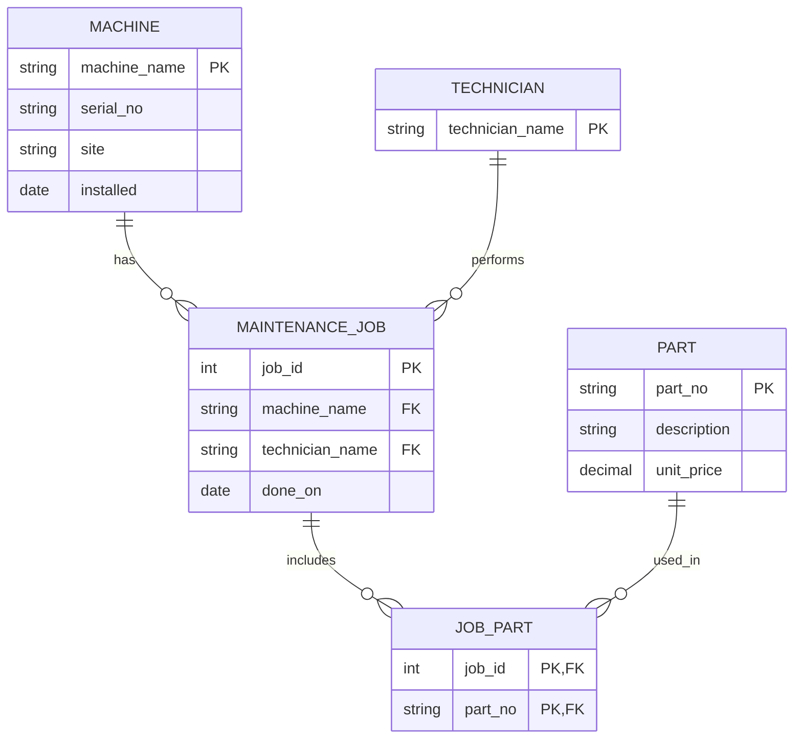

### Task 1: Reconstruct the ER Model

**Identified Entities & Intended Keys**

1. Machine
* **Attributes:** `machine_id` (Surrogate Key / candidate), `machine_name`, `serial_no`, `site`, `installed_date`
* **Intended Primary Key:** `serial_no` (Natural Key) or `machine_name` (Business Key).
  * *Audit Notes:* Currently lacks a `PRIMARY KEY` constraint or `NOT NULL` constraints. Using `machine_name` as a key is fragile if names change or are entered as placeholders (e.g., `'RANDOM-NAME'`). `installed` contains free-text values like `'unknown'`.

2. Part
* **Attributes:** `part_id` (Surrogate Key / candidate), `part_no`, `description`, `unit_price`
* **Intended Primary Key:** `part_no` (Natural Key).
  * *Audit Notes:* Lacks a `UNIQUE` or `PRIMARY KEY` constraint, leading to duplicate records in the legacy data (e.g., two entries for `'P-1003'`). `unit_price` is improperly typed as `TEXT` instead of `DECIMAL`/`NUMERIC`.

3. Technician
* **Attributes:** `technician_id` (Surrogate Key / candidate), `technician_name`
* **Intended Primary Key:** `technician_id` (or `technician_name` as a natural text key).
  * *Audit Notes:* Currently embedded as a plain `TEXT` attribute inside `maint_job`. It should be extracted into its own entity table to avoid text redundancy and typos.

4. Maintenance Job
* **Attributes:** `job_id`, `machine_id` (FK), `technician_id` (FK), `done_on`
* **Intended Primary Key:** `job_id` (Surrogate Key).
  * *Audit Notes:* Stores `machine_name` instead of a foreign key, resulting in orphaned records (e.g., job references `'cnc-05'`, which does not exist in `machine`). `done_on` is stored as text.

5. Maintenance Job Part (Junction Entity)
* **Attributes:** `job_id` (FK), `part_no` (FK), `quantity`
* **Intended Composite Primary Key:** `(job_id, part_no)`
  * *Audit Notes:* Currently represented as a comma-separated string in `maint_job.parts_used` (e.g., `'P-1001,P-1002'`), violating First Normal Form (1NF). Must be unnested into a proper $m:n$ junction table.

2. **Reconstructed ER Diagram**



3. **Cardinality Findings**

The database contains:
- **Machines:** 4 rows
- **Parts:** 4 rows, but only 3 distinct part numbers because P-1003 is duplicated.
- **Maintenance jobs:** 4 rows
- **Jobs using multiple parts:** Job 1 uses P-1001 and P-1002, so at least one job has multiple parts.
- **Invalid machine reference:** Job 3 refers to cnc-05, which is not present in the machine table.

4. Legacy schema models and hidden 

## Task 2: Find the integrity efects with queries

-- Defect 1: orphan maintenance jobs (machine_name not in machine)<br>
SELECT m.job_id, m.machine_name
FROM maint_job m
LEFT JOIN machine x ON m.machine_name = x.machine_name
WHERE x.machine_name IS NULL;
```
╭────────┬──────────────╮
│ job_id │ machine_name │
╞════════╪══════════════╡
│      3 │ cnc-05       │
╰────────┴──────────────╯
```
What breaks in production: job 3 references `cnc-05`, which doesn't exist in `machine`, so the job can't be attributed to any machine or site, and maintenance cost and downtime reports will silently leave it out.

-- Defect 2: duplicate natural keys in part<br>
SELECT part_no, COUNT(*) AS copies
FROM part GROUP BY part_no HAVING COUNT(*) > 1;
```
╭─────────┬────────╮
│ part_no │ copies │
╞═════════╪════════╡
│ P-1003  │      2 │
╰─────────┴────────╯
```
P-1003 exists twice in part, so any join on part_no returns two rows for it, which double-counts job costs and parts usage, and a price lookup can return either copy with no way to tell which is right.

-- Defect 3: unit_price stored as text — a numeric comparison fails silently<br>
SELECT part_no, unit_price FROM part WHERE unit_price < '15';   -- 'text ordering', not money!
```
╭─────────┬────────────╮
│ part_no │ unit_price │
╞═════════╪════════════╡
│ P-1001  │ '12.50'    │
╰─────────┴────────────╯
```
unit_price is stored as text, so < '15' compares characters instead of numbers and wrongly includes or excludes parts ('100.00' counts as “under 15”, '9.99' doesn’t), which can produce wrong price filters, totals, and invoices without any error.

-- Defect 4: installed dates that are not dates<r>
SELECT machine_name, installed FROM machine
WHERE installed NOT GLOB '[0-9][0-9][0-9][0-9]-[0-9][0-9]-[0-9][0-9]';
```
╭──────────────┬───────────╮
│ machine_name │ installed │
╞══════════════╪═══════════╡
│ RANDOM-NAME  │ unknown   │
╰──────────────┴───────────╯
```
Installed column is free text, so RANDOM-NAME holds 'unknown' instead of a date. Date arithmetic on it returns NULL or sorts wrongly, so warranty expiry and service-interval calculations silently skip or misjudge that machine, and nothing flags it.

-- Defect 5: the m:n list only "joins" when it holds exactly one part<br>
SELECT j.job_id, p.description
FROM maint_job j
JOIN part p ON p.part_no = j.parts_used;   -- the list is not a key
-- Watch what happens: job 2 ('P-1003') and job 3 ('P-1001') match, but job 1
-- ('P-1001,P-1002') silently disappears. A naive join on the list loses every
-- multi-part job — and reports success while doing it. That silence is the defect.
```
╭────────┬───────────────────╮
│ job_id │    description    │
╞════════╪═══════════════════╡
│      2 │ Coolant filter    │
│      2 │ Coolant filter    │
│      3 │ Ball bearing 6203 │
╰────────┴───────────────────╯
```
parts_used holds a comma-separated list, so joining on it matches only single-part jobs: job 1 ('P-1001,P-1002') silently vanishes from parts reports, and job 2 is double-counted because P-1003 is duplicated, so parts usage and cost come out wrong while the query still reports success.

### Task 3: Write the data contract in code

Python File: [contract.py](https://github.com/Emannual20/databases-portfolio/blob/main/Module02/contract.py)

Emitted DDL File: [emitted-ddel.sql](https://github.com/Emannual20/databases-portfolio/blob/main/Module02/emitted-ddl.sql)

Field Validator is the Pydantic checker in the Python code that checks if the Srrial Number begins with SN_ and for SQLite enforces rules such as nullable=False (NOT NULL) jects the row if that column is empty. Other rules and explanations:<br>
UniqueConstraint("serial_no")	Looks through existing values and rejects a repeat <br>
primary_key=True	Same as unique, and the value must also be present <br>
Composite key on job_part	Rejects a second row with the same job and part pair <br>
ForeignKey(...)	Looks up the referenced table and rejects the row if the target doesn’t exist (only if switched on, see below) <br>

## Task 4: Model inheritance and prove it