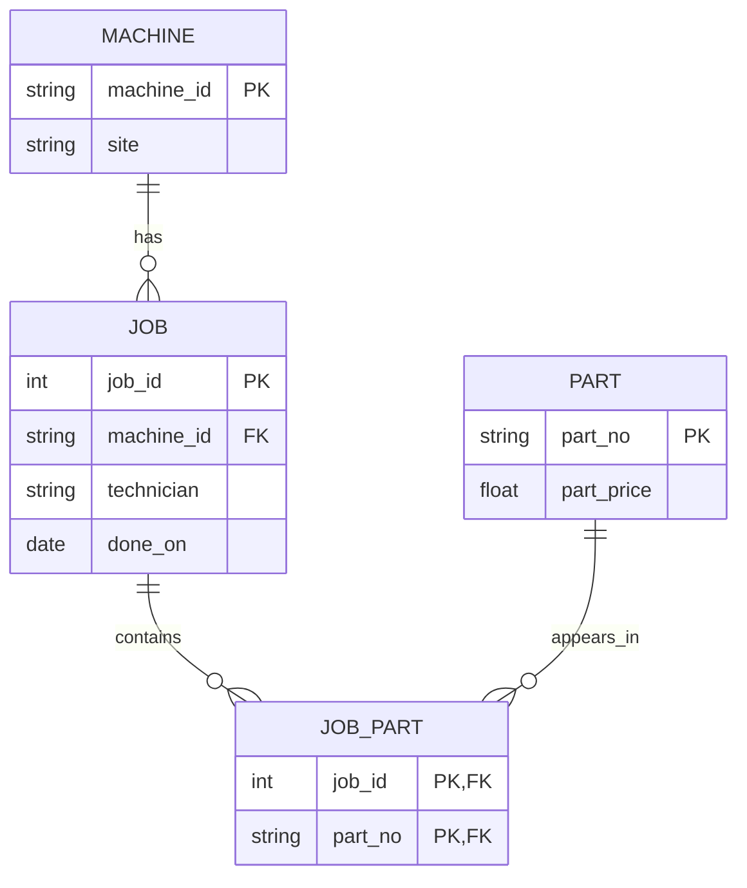

# Module 5: Normalization vs. Denormalization

## 🎯 Learning Goals
This module explores functional dependencies, normalization, and reporting trade-offs using a maintenance job and part dataset.

### Learning Goal 1:
Identify functional dependencies and a candidate key for a relation.
- [Round 1: Functional dependencies](normalization-notes.md#round-1-functionl-dependencies) - Recorded domain assumptions, observed-only dependencies, and the candidate key `(job_id, part_no)`.
- [Current and proposed ER sketches](README.md#evidence) - Flat relation and normalized schema diagrams.

### Learning Goal 2:
Explain how normalization removes partial and transitive dependencies and prevents update, insert, and delete anomalies.
- [Disappearing arrows in 3NF](normalization-notes.md#disappearing-arrows-in-3nf) - Traced where site and part price belong after decomposition.
- [Task 2: Break it](normalization-notes.md#task-2-break-it) - Demonstrated update, insert, and delete anomaly cases.
- [Normalization notes](normalization-notes.md) - Documents the 3NF decomposition and assumptions.

### Learning Goal 3:
Build and validate the normalized and reporting schemas with reproducible data.
- [Task 3: Built it](normalization-notes.md#task-3-built-it) - Links to row-count and integrity evidence.
- [Reproducible setup](setup.sql) - Builds the teaching and benchmark data.
- [Benchmark and validation](benchmark.md) - Records query-result validation, plans, and current measurements.

### Learning Goal 4:
Measure query speed, storage, and write amplification instead of assuming denormalization is faster.
- [Round 4: Race it](normalization-notes.md#round-4-race-it-performance-benchmark-results) - Records historical results and why workload shape matters.
- [Round 5: Price it](normalization-notes.md#round-5-price-it-storage--write-amplification-results) - Compares storage and rows touched by a site update.
- [Current benchmark results](benchmark.md) - Reproducible interleaved runs and query plans; use these in preference to earlier draft timings.
- [DuckDB comparison script](duck_compare.py) - Optional comparison across engines.

### Learning Goal 5:
Make and defend an architecture recommendation based on measured evidence and freshness requirements.
- [Round 6: Decide and defend](normalization-notes.md#round-6-decide-and-defend--architecture-recommendation) - Frames the transactional and reporting workload choices.
- [Recommendation memo](reccomendation_memo.md) - Contains the corrected recommendation based on the verified run.

## Reflection 5
[Reflection 5](../Reflections/ref05.md)

## Task Inspirations (Notes & Evidence)

## **1. Identify functional dependencies and a candidate key**
I listed which attributes are determined by the job, machine, or part, and separated domain assumptions from patterns that happened to appear in the small sample. A job can contain multiple parts, so `job_id` alone does not identify a job-part row; `(job_id, part_no)` is the candidate key used for the flat relation.

**Task Evidence:**
> **Round 1:** [Functional dependencies and candidate key](normalization-notes.md#round-1-functionl-dependencies)
> - [Original and proposed ER sketches](README.md#evidence)

## **2. Normalize the relation and inspect anomalies**
The 3NF design moves job facts to `job`, machine location to `machine`, part price to `part`, and each job-part pairing to a junction table. The anomaly exercises showed how repeating those facts in a flat table makes updates touch many rows and can cause inserts or deletes to lose unrelated facts.

**Task Evidence:**
> **Disappearing arrows:** [Dependencies removed by the decomposition](normalization-notes.md#disappearing-arrows-in-3nf)
> **Task 2:** [Update, insert, and delete anomalies](normalization-notes.md#task-2-break-it)
> **Normalization notes:** [3NF explanation](normalization-notes.md)

**Proposed normalized schema (3NF):**

The editable [Draw.io schema source](proposed_schema.drawio) contains the same design.

## **3. Build and validate both designs**
The setup script creates the data for the normalized and reporting designs. The benchmark checks that both queries return the same grouped results and records integrity checks alongside timing evidence, so performance comparisons are made over equivalent outputs.

**Task Evidence:**
> **Task 3:** [Build and validation notes](normalization-notes.md#task-3-built-it)
> - [Reproducible setup](setup.sql)
> - [Benchmark method and results](benchmark.md)

## **4. Measure speed, storage, and write costs**
Earlier draft measurements suggested the reporting table was faster, but the later reproducible validation run found the 3NF query's median at 126.6697 ms and the report query's median at 149.1518 ms on that specified workload. The report copy also used more allocated storage and a site change touched 4,000 report rows instead of one machine row. These results are specific to this dataset and run; they do not establish a universal ranking.

**Task Evidence:**
> **Round 4:** [Historical benchmark discussion](normalization-notes.md#round-4-race-it-performance-benchmark-results)
> **Round 5:** [Storage and write amplification](normalization-notes.md#round-5-price-it-storage--write-amplification-results)
> **Current measurements:** [Reproducible benchmark](benchmark.md)

## **5. Recommend an architecture for the workload**
The corrected recommendation keeps operational data normalized. A reporting copy is an option only when a real dashboard workload justifies its storage and refresh cost. The memo proposes an atomic scheduled rebuild when bounded staleness is acceptable, and querying normalized tables when a report needs immediate consistency.

**Task Evidence:**
> **Round 6:** [Architecture decision notes](normalization-notes.md#round-6-decide-and-defend--architecture-recommendation)
> **Recommendation:** [Corrected recommendation memo](reccomendation_memo.md)
